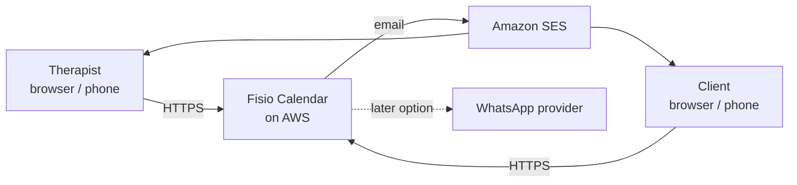
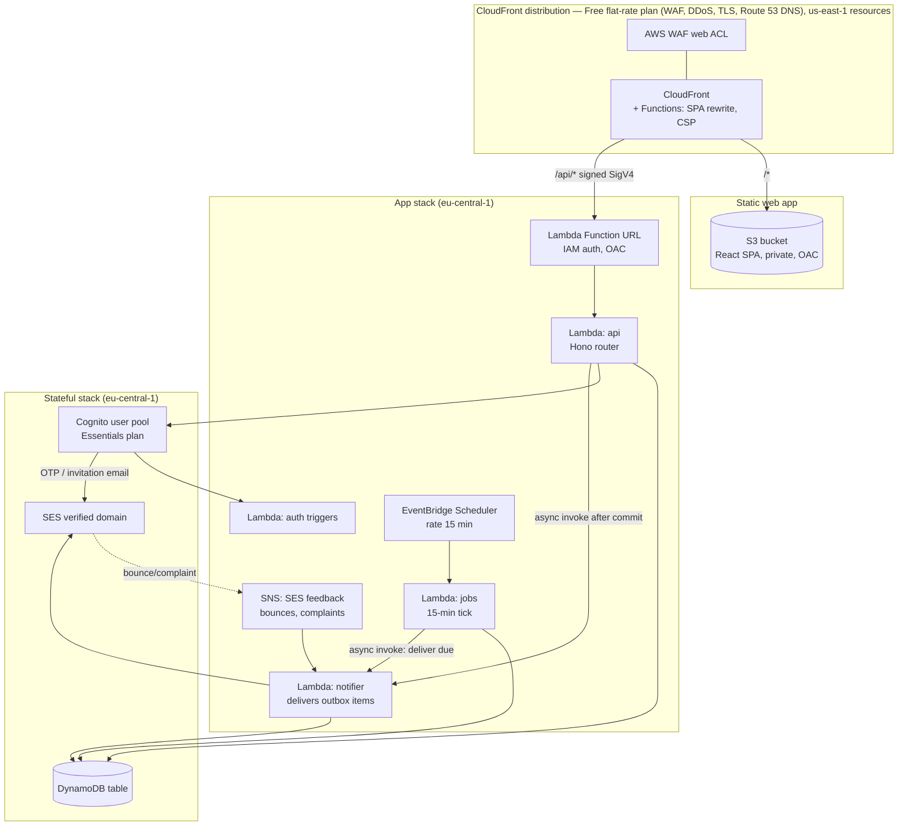
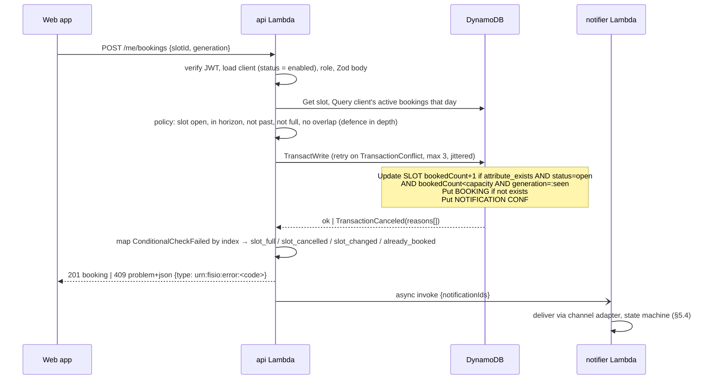

# Fisio Calendar — Architecture Document

| | |
|---|---|
| Status | **v1.2 — reviewed**; basis for the implementation plan |
| Date | 2026-10-24 |
| Source brief | `prompts/idea.md` |
| Decisions taken | All defaults proposed in the clarification round were accepted (§2) |
| v1.1 | WhatsApp deferred (email only in v1); local-first testing with a deploy gate (§11.4) |
| v1.2 | Engineering review (`/plan-eng-review`, 18 issues + independent second opinion). Main changes: one Cognito pool with per-user TOTP (§8); per-request client status check (§8.2); no-overlap invariant for slots of any type (§3.2); idempotent outbox keys and an explicit delivery state machine driven by the tick + async invoke, no Streams (§5.4); CloudFront → Lambda Function URL with OAC, no shared secret (§4.4, §9.1); SPA routing by CloudFront Function, no custom error responses (§11.1); reminder catch-up semantics (§5.3); cancel-day idempotency (§5.3); transaction-conflict retry (§5.3); therapist digest + bounce handling in M2 (§3.4); audit without PII (§9.4); spec catalogue (§10); three CDK stacks (§11.1); re-sliced roadmap (§13); i18next and PWA removed from v1 |
| v1.3 | **Headless UI journey specs** (§10.5): every UI flow is driven through the view-model classes' methods and Observable streams against the real in-process API, with recorded traces published as `docs/journeys.md`; view-model surface coverage enforced; Playwright reduced to binding checks |

---

## 1. Purpose and scope

Fisio Calendar lets one physiotherapist publish when they are available — in the **studio** or at the **swimming pool** — and lets their clients book and free those slots from a phone or a browser. The system reminds clients of tomorrow's appointments by email and tells them when the therapist cancels a slot or a whole day. WhatsApp is a later option the notification layer is prepared for.

This document describes **what** the application does (§3) and **how** it is built (§4–§12) in enough detail that the next step — an implementation plan — can be written directly from it. It fixes the technology choices and records why each was taken (§14). It does not contain code or step-by-step tasks.

### 1.1 Non-goals (v1)

- No payments, invoicing or receipts.
- No clinical notes, diagnoses or treatment history. The system stores *when* a client comes and *where* (studio/pool), nothing about *why*. This keeps the data outside GDPR Art. 9 special categories — a deliberate choice, not an omission.
- No recurring ("every Tuesday at 10") bookings, no waiting lists — both are on the backlog (§13, `TODOS.md`).
- No self-registration: only clients the therapist has added can log in.
- One therapist. The model is tenant-ready (every record carries the therapist id) but there is no sign-up, billing or isolation for multiple independent therapists.
- **No WhatsApp in v1.** Notifications are email only. The notification layer is built behind one interface so that a WhatsApp channel can be added later as one adapter plus templates, without touching use cases or data (§5.4, §12.1).
- No installable PWA and no second UI language in v1 (both in `TODOS.md`); the UI is Italian, built so a second language is a strings module away (§7.3).

---

## 2. Decisions fixed in the clarification round

| # | Topic | Decision |
|---|---|---|
| 1 | Tenancy | One therapist; data model tenant-ready, no multi-tenant features |
| 2 | Size | ≤ 200 active clients, ≤ 100 bookings/week (design envelope, not a limit) |
| 3 | Locale | Italy; Italian-only UI; timezone `Europe/Rome`; GDPR; documentation in English |
| 4 | Availability | Weekly recurring rules with per-day exceptions; fixed slot length per type; capacity per type (studio 1, pool 3), overridable per rule |
| 5 | Client rules | Book up to 4 weeks ahead; clients cannot free a slot less than 24 h before it starts; no cap on open bookings; therapist can book/cancel on behalf of a client |
| 6 | Recurring bookings | Post-v1 |
| 7 | Pool privacy | Clients see "1 of 3 places left", never other clients' names |
| 8 | WhatsApp | **Not in v1 — email is the only channel.** Provider-agnostic notification layer so WhatsApp can be added later (§12.1) |
| 9 | Reminder time | Configurable by the therapist; default **19:00 the evening before** |
| 10 | Extra notifications | Booking confirmation to the client. Therapist: immediate email only for client cancellations and delivery failures; everything else in a daily digest (§3.4, review decision 7A). Per-client channel preferences kept in the model for the later WhatsApp option |
| 11 | Authentication | Clients: passwordless (one-time code by email, long-lived session). Therapist: email + password + TOTP |
| 12 | Hosting | Own domain; AWS `eu-central-1` (Frankfurt); edge resources in `us-east-1` as CloudFront requires |
| 13 | Budget | ≈ €1–5/month acceptable; AWS Budgets **alarms** plus reserved concurrency and WAF rate limits as the actual throttles (§9.3) |
| 14 | Front end | React + TypeScript + RxJS view-models (MVVM) |
| 15 | Tests | Descriptive Vitest specs as executable documentation + Playwright journeys; no Gherkin |
| 16 | Local-first | Every component runs and is tested locally without deploying anything; `dev` and then `prod` are deployed only after the full local suite is green (§11.4) |

---

## 3. Functional specification

### 3.1 Actors

| Actor | Description |
|---|---|
| **Therapist** | Owns the calendar. Defines availability, manages clients, cancels slots/days, books on behalf of clients, configures settings. |
| **Client** | Added by the therapist. Sees availability, books and frees slots, receives notifications. States: `invited` → `enabled` ⇄ `blocked`. |
| **Scheduler** | System actor (the 15-minute tick). Extends the slot horizon, creates reminders and the daily digest, delivers due notifications, sweeps stuck ones. |
| **Notification provider** | Amazon SES (email). A WhatsApp provider is a later option behind the same interface. |

### 3.2 Core concepts and business rules

**Slot type** — `studio` or `pool`. Each type has a default slot duration and a default capacity (studio 1, pool 3). Both are therapist settings.

**Availability rule** — "every *weekday* from *start* to *end*, type *T*, slot length *L*, capacity *C*, valid from *date* [to *date*]". Example: *Mon 09:00–13:00 studio 60 min cap 1*, *Wed 17:00–19:00 pool 60 min cap 3*.

**Invariant: no two slots ever overlap in time, whatever their type.** One therapist is in one place at a time. Rule validation refuses any time overlap between rules whose weekday and validity ranges intersect, regardless of type. Slot generation never creates a slot that overlaps an existing slot — including a booked slot that no longer matches any rule — and reports what it skipped. The client-side rule "no two active bookings that overlap" remains only as defence in depth. *(Review decision 6A.)*

**Slot** — a concrete occurrence generated from a rule: date, start, end, type, capacity, status `open | cancelled`, `bookedCount`, `generation` (an integer bumped whenever regeneration replaces the slot — the optimistic-concurrency token the client echoes when booking). Slots are **materialised** (stored) for the booking horizon so that capacity can be enforced with a conditional write and a cancelled slot has a durable identity. Identity: `SlotId = <date>T<HH:mm>#<type>` — unique within the therapist, owned by one module (§5.1).

**Booking** — one client in one slot. Status `active | cancelled_by_client | cancelled_by_therapist`. A client holds at most one booking per slot (guaranteed by the key).

**Horizon** — clients can book from *now* up to `bookingHorizonDays` (default 28) ahead. Slots are generated for horizon + 7 days of buffer and extended nightly.

**Cancellation deadline** — `clientCancelCutoffHours` (default 24). Freeing a slot at or after the deadline is refused with an explanatory message ("contact your therapist"). The therapist is not subject to the deadline.

**Rule change with existing bookings** — regeneration deletes future slots **conditionally** (`bookedCount = 0`) and recreates them with `generation + 1`. A booked slot that no longer matches any rule is kept and flagged `orphaned`; no new slot may overlap it; the therapist sees orphaned slots on the dashboard and decides (keep, or cancel-and-notify). A client booking against a stale calendar receives `409 slot_changed` and the calendar reloads. *(Decisions 6A, 11A.)*

**Blocking a client** — takes effect on the client's **next request**: the API checks the client's status on every call (§8.2), and the Cognito user is disabled with all refresh tokens revoked. Existing active bookings are **kept** unless the therapist cancels them explicitly. *(Decision 2A.)*

**Time** — all persisted instants are UTC ISO-8601. Slot generation, "tomorrow", deadlines and display use the therapist's timezone (`Europe/Rome`), including DST transitions.

### 3.3 Features by actor

Each feature below maps to rows of the spec catalogue in §10.4; acceptance criteria are written as the spec titles will read.

#### Therapist

| ID | Feature | Acceptance criteria (spec titles) |
|---|---|---|
| T1 | Sign in with TOTP | signs in with email, password and TOTP code · is always challenged for TOTP (contract spec) · cannot sign in without the code · is signed out of all devices on password change |
| T2 | Manage settings | sets slot duration and capacity per type · sets booking horizon, cancellation cutoff, reminder time and digest time · changes take effect on the next slot generation |
| T3 | Define availability rules | creates a weekly rule · a rule overlapping any other rule in time (any type) is refused with `rule_overlap` · a rule with a valid-to date stops generating slots after it · editing a rule regenerates only unbooked future slots · booked slots that no longer match are flagged orphaned · no generated slot overlaps a booked slot |
| T4 | View calendar | sees week and day views with capacity, booked clients' names and status · navigates past and future weeks · sees orphaned and cancelled slots distinctly |
| T5 | Cancel a slot | cancels an open slot with an optional reason · every client booked in it is notified by email · a cancelled slot cannot be booked · a cancelled slot without bookings can be reopened · cancelling an already-cancelled slot is a no-op |
| T6 | Cancel a day | cancels every open slot of a day · receives a per-slot outcome list (cancelled / already cancelled / failed) · a retry after a partial failure completes the day and sends no duplicate notification · each affected client receives exactly one email per booking |
| T7 | Manage clients | adds a client with name, email, phone · the client receives an invitation · a duplicate email is refused · enables, blocks and unblocks a client · a blocked client's next request is refused even with a still-valid token · resends an invitation · sees "invited, never signed in" after 7 days · sees "email bounced" · deletes a client (GDPR erasure, §9.4) |
| T8 | Book on behalf | books a client into a slot · frees a client's booking regardless of the cutoff · both actions notify the client |
| T9 | Notification log | sees sent, pending and failed notifications with channel, attempts and last error · retries a failed notification |
| T10 | Dashboard and digest | sees today's and tomorrow's bookings, orphaned slots, failed notifications, bounced and never-signed-in clients · receives the same as a daily email digest at the configured time |

#### Client

| ID | Feature | Acceptance criteria (spec titles) |
|---|---|---|
| C1 | Sign in without a password | enters email, receives a one-time code, enters it and is signed in · stays signed in on the device for 30 days · an unknown or blocked email is refused without revealing whether it exists · a wrong code is refused · five wrong codes lock the attempt temporarily · an expired code is refused with a clear message |
| C2 | See availability | sees open slots of both types for the next 4 weeks with places left · does not see other clients' names · the response contains no other client's booking item · does not see slots beyond the horizon or in the past |
| C3 | Book a slot | books an open slot with places left · cannot book a full slot · two clients booking the last place at the same instant: one succeeds, one sees `slot_full` · booking a slot that was regenerated meanwhile gives `slot_changed` and the calendar reloads · a double click produces one booking · receives a confirmation |
| C4 | Free a slot | frees an own booking more than 24 h before start · is refused at exactly 24 h and after, with an explanation · the therapist is notified |
| C5 | My bookings | sees upcoming and past bookings · sees cancellations by the therapist with the reason |
| C6 | Reminders | receives, at the configured time the day before, one reminder email per booking with type and time |

#### System

| ID | Feature | Acceptance criteria |
|---|---|---|
| S1 | Slot horizon | slots exist for every rule up to horizon + 7 days · generation is idempotent · no two slots overlap · DST days produce correct local times |
| S2 | Reminders | sent once per booking per day even if the job runs twice or crashes between writes · a tick after a missed reminder time still sends them the same day · not sent for cancelled bookings · one message per enabled channel (v1: email) |
| S3 | Delivery | a transient failure is retried with back-off (1, 5, 30, 120 min) · a permanent failure marks the notification failed and alerts the therapist · an item stuck in `sending` is recovered by the sweep · after 5 attempts the item is failed |
| S4 | Audit | every booking, cancellation, client state change and settings change is recorded with actor, action, target and changed field names — never with personal data values |

### 3.4 Notification matrix

| Event | Client | Therapist |
|---|---|---|
| Invitation | email (always) | — |
| Booking created (by client or therapist) | confirmation email | in daily digest |
| Booking freed by client | — | **immediate email** |
| Booking cancelled by therapist (single or day) | email, with reason | — |
| Reminder, day before at configured time | email | — |
| Notification failed after retries, or address bounced | — | **immediate email** + dashboard |
| Daily digest (configurable, default 07:30) | — | new bookings since last digest, tomorrow's schedule, orphaned slots, failed notifications, bounced and never-signed-in clients |

*(Decision 7A: the therapist's inbox receives only what needs action; routine news arrives once a day.)*

v1 sends email only. The client's `channels` attribute (`{email: true, whatsapp: false}`) and the one-notification-item-per-channel outbox exist from the start, so the later WhatsApp option is enabled per client with a settings change and one new adapter — no data migration (§12.1).

### 3.5 Message content (Italian, templates)

- *Reminder*: "Ciao {nome}, ti ricordiamo l'appuntamento di domani {data} alle {ora} in {studio|piscina}."
- *Cancellation*: "Ciao {nome}, l'appuntamento del {data} alle {ora} in {studio|piscina} è stato annullato. {motivo}"
- *Confirmation*: "Ciao {nome}, confermiamo l'appuntamento del {data} alle {ora} in {studio|piscina}."
- *Invitation*: link to the app + how to sign in.
- *Digest* (therapist): sections as in §3.4.

Emails carry this text in a minimal HTML layout with a plain-text alternative. If WhatsApp is added later, the same texts become pre-approved Meta **Utility** templates.

---

## 4. Architecture overview

### 4.1 Principles

1. **Serverless and always-free first.** Every component is chosen from services with an always-free allowance that covers the design envelope several times over (§12). Nothing runs when nobody uses the app.
2. **Security is a first-class requirement** — invite-only identities, TOTP for the therapist, every API call authenticated and authorised in code with the caller's current status, the API reachable only through CloudFront + WAF (cryptographically, not by shared secret), least-privilege IAM, no secrets in code, EU data residency (§9).
3. **One language, one toolchain.** TypeScript everywhere (front end, API, jobs, infrastructure) with domain types, validation schemas and the error catalogue shared between client and server.
4. **Tests are the documentation.** Each feature in §3.3 has spec rows in §10.4, and every UI flow is a headless journey (§10.5) whose recorded sequence of view-model calls, stream emissions, API requests and emails is published as documentation on every CI run.
5. **Boring technology.** Mainstream, well-documented libraries that an AI coding agent and a human maintainer both know well. Managed identity (Cognito) rather than owned auth code; the simplest delivery transport that meets the guarantee (the tick plus an async invoke, not a streaming pipeline).
6. **Local first.** The whole system runs on a laptop with Docker and Node — database, email, authentication, scheduled jobs, notification delivery — and the complete test suite, end-to-end journeys included, passes there before anything is deployed. Cloud services are reached only through narrow ports (`Repository`, `NotificationChannel`, `IdentityProvider`, `Clock`, `Config`, `AsyncInvoker`) that have local implementations (§11.4).

### 4.2 System context



### 4.3 Containers



| Container | Technology | Responsibility |
|---|---|---|
| **Web app** | React 19, TypeScript, Vite, RxJS, served from S3 via CloudFront | All UI for both actors. Pure templates + view-model classes (§7). |
| **api** Lambda | Node.js 22 (arm64), Hono, Zod; exposed through a Function URL (IAM auth) reachable only from CloudFront via OAC | Every synchronous use case: auth checks, booking transactions, admin operations, OpenAPI. Reserved concurrency 10. |
| **jobs** Lambda | Node.js 22 | Ticked every 15 min: extend slot horizon (daily), create reminders (catch-up semantics), build the digest, deliver due notifications, sweep stuck ones. |
| **notifier** Lambda | Node.js 22 | Delivers `NOTIFICATION` items through the channel adapters according to the state machine (§5.4). Invoked asynchronously by `api` right after a commit and by `jobs` on every tick. Also handles SES bounce/complaint events from SNS. |
| **auth triggers** Lambda | Node.js 22 | Cognito triggers: custom message (Italian OTP/invitation emails), pre-token-generation (`role`, `tenantId` claims), pre-authentication (refuses blocked clients at sign-in). |
| **DynamoDB** | Single table, on-demand, PITR, TTL | All application data (§6). No Streams. |
| **Cognito** | User pool, Essentials plan, managed login domain | Identities, passwordless OTP for clients, password + TOTP for the therapist, token issuance. |
| **CloudFront + WAF + Route 53** | Free flat-rate plan (`AWS::PricingPlanManager::Subscription`, tier `FREE`) | TLS, DNS, caching, WAF managed rules, IP rate limiting, SPA routing and security headers via CloudFront Functions. |
| **SES** | Verified domain, DKIM/SPF/DMARC, configuration set with feedback to SNS | All email, including Cognito's. |

### 4.4 Request path

1. Browser loads the SPA from CloudFront (S3 origin, OAC — the bucket is private). A viewer-request CloudFront Function rewrites extension-less paths to `/index.html`; a viewer-response Function adds the CSP.
2. The SPA authenticates against Cognito (Amplify Auth, `USER_AUTH` flow). It receives ID/access/refresh tokens.
3. API calls go to `https://<domain>/api/v1/...` — the **same origin** as the SPA, so no CORS. CloudFront forwards `/api/*` to the Lambda Function URL and signs the request (SigV4) through Origin Access Control; the Function URL requires IAM auth, so a direct call to it is refused with 403. For requests with a body the SPA's fetch wrapper adds `x-amz-content-sha256` (SHA-256 of the payload, WebCrypto), which OAC requires to sign the body. *(Decision T3.)*
4. The `api` Lambda (Hono) verifies the JWT (`aws-jwt-verify`), loads the caller's client item and refuses any status other than `enabled` (§8.2), validates the body with Zod, runs the use case, writes to DynamoDB in a transaction (with conflict retry, §5.3), returns JSON.
5. State changes that need a notification write `NOTIFICATION` items **in the same transaction** (transactional outbox, deterministic keys). After the commit the API asynchronously invokes `notifier` for those items; the 15-minute tick delivers anything the async invoke missed and runs retries (§5.4).

---

## 5. Backend design

### 5.1 Code structure (monorepo, pnpm workspaces)

```
fisio-calendar/
├─ apps/
│  ├─ web/                 React SPA
│  │  ├─ src/pages/        templates (.tsx) — binding only, no logic
│  │  ├─ src/viewmodels/   view-model classes (extend ViewModel; observables + methods)
│  │  ├─ src/services/     ApiClient (typed, injectable fetch), AuthService, Strings, Clock
│  │  └─ test/journeys/    headless UI journeys (§10.5): real view-models + real in-process API
│  └─ api/                 Lambda code
│     ├─ src/http/         Hono app, routes, middleware (jwt, client-status, errors → problem+json)
│     ├─ src/usecases/     application services (BookSlot, CancelDay, GenerateSlots, CreateReminders, BuildDigest, …)
│     ├─ src/repo/         DynamoDB repositories — the only place that builds keys (from domain ids)
│     ├─ src/notify/       NotificationChannel adapters: SesEmailChannel (cloud), SmtpEmailChannel (local → Mailpit), FakeChannel (specs)
│     ├─ src/identity/     IdentityProvider port: CognitoIdentityProvider (cloud), LocalIdentityProvider (local emulator)
│     ├─ src/handlers/     Lambda entry points: api.ts, jobs.ts, notifier.ts, auth-triggers.ts
│     ├─ src/runtime/      composition roots: lambda.ts (AWS adapters) and local.ts (local adapters, in-process AsyncInvoker, /__dev routes)
│     └─ test/             API specs (executable documentation), fault-injection doubles
├─ packages/
│  ├─ domain/              pure TypeScript, no AWS: slot-id.ts, rules & slot generation (overlap invariant), booking policy, notification state machine, time helpers
│  ├─ contracts/           Zod schemas + DTO types shared by web and api; errors.ts (ErrorCode catalogue + HTTP mapping); OpenAPI generated from here
│  └─ testkit/             shared test tooling: in-process fetch adapter (Hono app.request), ObservableRecorder, TraceRecorder, JourneyHarness, FaultInjectingDynamo, fake JWTs, FakeChannel/Mailpit readers, journey report renderer
├─ infra/                  AWS CDK app (TypeScript): Stateful, App, Edge stacks + assertions + bundle smoke
├─ tools/
│  ├─ local/               docker-compose (DynamoDB Local, Mailpit), auth emulator, tick runner, seed
│  └─ bootstrap/           `bootstrap:therapist` CLI (same IdentityProvider port; local, dev, prod)
├─ e2e/                    Playwright journeys against the local stack
├─ docs/                   this document, TODOS.md, generated spec report, OpenAPI
└─ .github/workflows/      CI/CD
```

The **domain** package has no I/O and no AWS dependency: it is where the rules in §3.2 live and where most unit specs run in milliseconds. Two definitions used by every layer live in exactly one place *(decision 14A)*: `packages/domain/slot-id.ts` (branded `SlotId`, `format()`/`parse()`) and `packages/contracts/errors.ts` (the `ErrorCode` catalogue below). Repository keys are derived from domain ids, never hand-built.

### 5.2 API

- Style: JSON over HTTPS, `/api/v1` prefix, resource-oriented, errors as RFC 9457 `application/problem+json` whose `type` is `urn:fisio:error:<code>`.
- Framework: **Hono** with `@hono/zod-openapi` — routes declare their Zod request/response schemas once; the same declaration validates at runtime, types the handler, and generates the OpenAPI document published to `docs/openapi.json`. Hono runs on Lambda (`hono/aws-lambda`), in Node for local development (`@hono/node-server`), and **in-process in tests** (`app.request()`).
- One Lambda for the whole API: one artifact, one cold start to warm, trivial to test; with < 1 request/s there is nothing to gain from per-route functions.

#### Error catalogue (`packages/contracts/errors.ts`)

| Code | HTTP | Meaning |
|---|---|---|
| `validation_failed` | 400 | Zod rejected the request (details list the paths) |
| `unauthenticated` | 401 | Missing or invalid token |
| `forbidden` | 403 | Wrong role, not the owner, or client status is not `enabled` |
| `not_found` | 404 | Resource does not exist for this caller |
| `slot_full` · `slot_cancelled` · `slot_past` · `slot_outside_horizon` | 409 / 422 | Booking refused by slot state |
| `slot_changed` | 409 | Slot `generation` differs from the one the client displayed — reload |
| `already_booked` | 409 | Client already holds a booking in this slot |
| `overlapping_booking` | 409 | Defence-in-depth check (§3.2) |
| `cutoff_passed` | 422 | Client tried to free a slot at or after the cutoff |
| `rule_overlap` | 422 | Rule would overlap another rule in time (any type) |
| `client_exists` | 409 | A client with this email exists |
| `client_blocked` | 403 | Operation refused because the client is blocked |
| `conflict_retry_exhausted` | 503 | Transaction conflicts persisted after 3 attempts — retry later |

The SPA maps codes to Italian strings; specs assert codes, never sentences.

#### Endpoints

| Method & path | Actor | Purpose |
|---|---|---|
| `GET /health` | public | liveness |
| `GET /me` | client, therapist | profile, role, settings relevant to the caller |
| `GET /slots?from&to` | client | open slots in range with `placesLeft` and `generation` (max range = horizon; query filtered to slot items) |
| `GET /me/bookings?from&to` | client | own bookings |
| `POST /me/bookings` `{slotId, generation}` | client | book (C3) |
| `DELETE /me/bookings/{bookingId}` | client | free (C4, cutoff enforced) |
| `GET /admin/settings` · `PUT /admin/settings` | therapist | T2 |
| `GET/POST /admin/rules` · `PUT/DELETE /admin/rules/{id}` | therapist | T3 (validation enforces the overlap invariant; response lists orphaned/skipped slots) |
| `GET /admin/slots?from&to` | therapist | slots with bookings and client names (T4) |
| `POST /admin/slots/{slotId}/cancel` `{reason?}` · `POST /admin/slots/{slotId}/reopen` | therapist | T5 (idempotent) |
| `POST /admin/days/{date}/cancel` `{reason?}` | therapist | T6 — returns `{results: [{slotId, outcome: cancelled \| already_cancelled \| failed, error?}]}` |
| `GET/POST /admin/clients` · `GET/PATCH/DELETE /admin/clients/{id}` | therapist | T7 (PATCH: status, channels, contact data) |
| `POST /admin/clients/{id}/invite` · `GET /admin/clients/{id}/export` | therapist | resend invitation · GDPR export (JSON) |
| `POST /admin/bookings` `{slotId, clientId}` · `DELETE /admin/bookings/{id}` | therapist | T8 |
| `GET /admin/notifications?from&status` · `POST /admin/notifications/{id}/retry` | therapist | T9 |
| `GET /admin/dashboard` | therapist | T10 |
| `POST /__dev/tick` `{now}` · `POST /__dev/deliver` | local runtime only | run the tick / deliver due items at a chosen instant; not mounted in the Lambda runtime (asserted by the bundle smoke, §10) |

Authorisation: `/admin/*` requires the `therapist` role; `/me/*` and `/slots` require `client` or `therapist`; every client-scoped query takes the client id **from the token**, never from the request; every request first passes the client-status check (§8.2).

### 5.3 Key use cases

**Book a slot** (client or therapist on behalf)



The conditions inside the transaction are the source of truth *(decisions 10A, 11A)*: `attribute_exists` prevents an `UpdateItem` from resurrecting a slot that regeneration just deleted; `generation = :seen` turns a stale calendar into a clean `409 slot_changed`; `bookedCount < capacity` guarantees the pool is never overbooked. Under true concurrency DynamoDB cancels one of two simultaneous transactions with reason `TransactionConflict` (not a failed condition); the repository retries those up to 3 times with jitter (50–200 ms), then maps `ConditionalCheckFailed` reasons by index to the error codes above. DynamoDB Local never raises `TransactionConflict`, so the API specs use a `FaultInjectingDynamo` double that throws it once (§10).

**Cancel a slot / cancel a day** (therapist) *(decision 4A)*. Each slot is one transaction, conditional on `status = open`: slot → `cancelled`, each active booking → `cancelled_by_therapist`, one `CANC#<bookingId>#email` notification per booking, one `AUDIT`. An already-cancelled slot is reported as `already_cancelled`, not failed. Cancel-day runs the slots of the day in sequence and returns the per-slot outcome list; the UI shows it and offers "retry remaining". Retry is therefore always safe and never duplicates a notification (deterministic keys). After the loop the API asynchronously invokes `notifier`.

**Reminders** (jobs Lambda, every 15 minutes) *(decisions 3A, 9A)*

1. Load settings; compute `now` in `Europe/Rome`. If `now ≥ reminderTime` today **and** the marker `JOB#reminders#<tomorrow>` is absent → proceed; otherwise exit. (Catch-up semantics: a missed or failed 19:00 run is repaired by any later tick until local midnight.)
2. Query tomorrow's slots and active bookings (one partition query, §6.3).
3. For each booking and each enabled channel, `Put NOTIFICATION` with key `REM#<bookingId>#<channel>#<date>` and `attribute_not_exists` — idempotent across reruns and across a crash between puts.
4. Write the marker last. Invoke `notifier` asynchronously.
5. A CloudWatch alarm fires if the marker is still absent 60 minutes after `reminderTime`.

The same tick also runs: **extend-horizon** once a day (03:00 local, idempotent, enforcing the no-overlap invariant), **digest** at `digestTime` (default 07:30; marker `JOB#digest#<date>`; one `DIGEST#<date>#email` notification to the therapist), **deliver-due** (all `pending` items whose `nextAttemptAt ≤ now`) and **sweep** (items in `sending` for more than 10 minutes go back to `pending` with `attempts + 1`).

### 5.4 Notification pipeline (transactional outbox, explicit state machine)

A `NOTIFICATION` item is the unit of work: `{kind, bookingId?, clientId?, channel, to, template, params, status, attempts, nextAttemptAt, lastError, providerMessageId, createdAt, sentAt, ttl}`. It is written **in the same transaction** as the business change → never lost, never sent for a rolled-back change. Keys are **deterministic** (§6.2), so every write is idempotent and a booking can have at most one confirmation and one cancellation.

**State machine** *(decision 12A)*, implemented as pure functions in `packages/domain/notification-state.ts`:

```
                 deliver (conditional update, only from pending with nextAttemptAt <= now)
   +---------+ ------------------------------------------------>  +---------+
   | pending |                                                    | sending |
   +---------+ <-----------------------------------------------   +---------+
      ^   |      retryable error: attempts+1,                        |   |
      |   |      nextAttemptAt = now + backoff(attempts)             |   |
      |   |      (1, 5, 30, 120 min); attempts >= 5 -> failed        |   | provider accepted
      |   |                                                          |   v
      |   |      sweep: sending older than 10 min -> pending       +--------+
      |   +------------------------------------------------------> | sent   |
      |                                                            +--------+
      |          permanent error (bad address, template error)
      |          or attempts >= 5                                  +--------+
      +----------------------------------------------------------> | failed | --> therapist alert, dashboard, manual retry (T9 resets to pending)
                                                                   +--------+
```

**Delivery triggers** *(decision T2 — no DynamoDB Streams)*:

- **Immediate**: after a successful commit the API (or the jobs Lambda) invokes `notifier` asynchronously (`InvocationType: Event`) with the notification ids it just wrote. Lambda's async invoke retries twice on its own; the conditional `pending → sending` update makes duplicate invocations harmless.
- **Eventual**: every 15-minute tick runs deliver-due, which picks up anything the async invoke missed and every item whose back-off has elapsed. Worst-case delay for a confirmation whose async invoke failed: 15 minutes.
- Locally the `AsyncInvoker` port is an in-process call (`setImmediate`), so the same code path runs on a laptop with no emulator.

Why not Streams: the outbox item plus deterministic keys already give the guarantee; Streams would add an event-source mapping, a DLQ, stream-specific retry semantics and a local poller for ~70 emails a day. The tick exists anyway. *(§14, D6.)*

**Channel adapters** implement one interface:

```ts
interface NotificationChannel {
  readonly name: 'email' | 'whatsapp';
  send(msg: RenderedMessage): Promise<{ providerMessageId: string }>;   // throws RetryableError | PermanentError
}
```

`SesEmailChannel` (AWS SDK v3 `SendEmail`, cloud runtime), `SmtpEmailChannel` (nodemailer → Mailpit, local runtime), `FakeChannel` (records calls; used by every spec). A `WhatsAppChannel` is the planned later addition. Templates live in `packages/contracts` as typed render functions, so a spec can assert "client receives a reminder for pool at 17:00" against rendered text.

**SES feedback** *(decision 7A)*: the SES configuration set publishes bounces and complaints to an SNS topic that invokes `notifier`'s `ses-feedback` handler: the client's `emailStatus` becomes `bounced` or `complained`, a `FAIL#<clientId>#<date>` notification alerts the therapist, and the dashboard lists the client.

### 5.5 Time handling

`date-fns` v4 with `@date-fns/tz`. All slot generation iterates **local** wall-clock times in `Europe/Rome` and converts to UTC for storage, so a 09:00 slot is 09:00 on both sides of a DST switch. Specs cover the two DST Sundays explicitly (S1). A `Clock` abstraction is injected everywhere so specs run at a fixed instant.

---

## 6. Data model (DynamoDB)

### 6.1 Why DynamoDB and not MongoDB Atlas

| | DynamoDB | MongoDB Atlas M0 |
|---|---|---|
| Free allowance | Always free: 25 GB storage, 25 WCU/RCU provisioned (or on-demand at ≈ €1.4 per million writes — cents at our volume) | Free forever, 512 MB, shared cluster |
| Access from Lambda | IAM role, no credentials, no connection pool, no VPC | Connection string in a secret, TLS over the public internet, connection reuse caveats in Lambda |
| Transactions / conditional writes | Native (`TransactWriteItems`, condition expressions) | Multi-document transactions on M0 supported, but overbooking protection needs care |
| Backups, encryption, TTL | Built in (PITR, KMS, TTL) | Not on M0 (backups) |
| Vendors / accounts | AWS only | A second vendor, account, billing, GDPR processor |
| Query flexibility | Access patterns designed up front (§6.3) | Ad-hoc queries, aggregation pipeline |

Our access patterns are few and known (§6.3), so DynamoDB's main weakness does not bite, and its strengths (atomic capacity check, zero credentials) match the requirements exactly. The repository layer isolates the decision.

### 6.2 Table layout (single table `fisio-<stage>`)

All keys are prefixed with the therapist id `T#<tid>` — the tenant-readiness mentioned in §1.1, and what makes API specs parallel-safe (§10.3).

| Entity | PK | SK | Notable attributes |
|---|---|---|---|
| Settings | `T#<tid>` | `SETTINGS` | timezone, durations, capacities, horizonDays, cutoffHours, reminderTime, digestTime, therapist contact |
| Client | `T#<tid>` | `CLIENT#<clientId>` | name, email, phone (E.164), status, channels `{email, whatsapp}`, emailStatus `ok \| bounced \| complained`, locale (`it`), consentAt, invitedAt, lastSignInAt, createdAt. `clientId` = Cognito `sub` |
| Availability rule | `T#<tid>` | `RULE#<ruleId>` | type, weekday, start, end, slotMinutes, capacity, validFrom, validTo, active |
| Slot | `T#<tid>#M#<yyyy-mm>` | `<SlotId>#S` | end, capacity, bookedCount, status, generation, ruleId, orphaned, cancelReason, entity=`SLOT` |
| Booking | `T#<tid>#M#<yyyy-mm>` | `<SlotId>#B#<clientId>` | bookingId, status, createdBy, createdAt, cancelledAt, cancelReason, startUtc, entity=`BOOKING` |
| Notification | `T#<tid>#N#<yyyy-mm>` | **deterministic**: `REM#<bookingId>#<channel>#<date>` · `CONF#<bookingId>#<channel>` · `CANC#<bookingId>#<channel>` · `INVITE#<clientId>#<attempt>` · `DIGEST#<date>#email` · `FAIL#<clientId>#<date>` | see §5.4; `ttl` = 180 days |
| Audit | `T#<tid>#A#<yyyy-mm>` | `<tsIso>#<id>` | actor, action, target id, **changed field names only** (no values), reason; `ttl` = 365 days |
| Job marker | `T#<tid>` | `JOB#<name>#<date>` | ranAt; `ttl` = 7 days |

Global secondary indexes:

| Index | PK | SK | Serves |
|---|---|---|---|
| `GSI1` | `CLIENT#<clientId>` | `<startUtc>` (bookings) | a client's upcoming/past bookings |
| `GSI2` | `EMAIL#<email>` | `CLIENT` (clients) | uniqueness check on add; lookup by email |

### 6.3 Access patterns

| # | Pattern | Query |
|---|---|---|
| 1 | Settings | `Get T#tid / SETTINGS` |
| 2 | List clients · get client (also on every authenticated request) | `Query PK=T#tid, SK begins_with CLIENT#` · `Get` |
| 3 | List rules | `Query PK=T#tid, SK begins_with RULE#` |
| 4 | Calendar range | `Query PK=T#tid#M#yyyy-mm, SK between <from> and <to>~` — one query per month touched (1–2 for 4 weeks). Therapist route: slots and bookings together. Client route: `FilterExpression entity = SLOT` (same RCU, a quarter of the payload) *(decision 18A)* |
| 5 | A day's slots and bookings (reminders, cancel day) | same as 4 with `begins_with <yyyy-mm-dd>` |
| 6 | Client's bookings | `Query GSI1 PK=CLIENT#id, SK ≥ now` |
| 7 | Overlap check on booking (defence in depth) | pattern 5 for that day filtered by client |
| 8 | Notifications log | `Query PK=T#tid#N#yyyy-mm`, sorted by `createdAt` in code (a few hundred items/month) |
| 9 | Deliver-due and sweep | pattern 8 for the current and previous month with `FilterExpression status = pending AND nextAttemptAt <= :now` (or `status = sending AND updatedAt < :stale`) |

Client-facing responses are **projected** in the service layer: a client never receives booking items other than their own; slots carry only `placesLeft` and `generation`.

### 6.4 Table settings

On-demand capacity, point-in-time recovery, TTL on `ttl`, deletion protection in `prod`, encryption with the AWS-owned key. No Streams.

---

## 7. Front-end design

### 7.1 Pattern: templates without logic, view-models with RxJS

The brief asks for "HTML pages which contain no logic and a set of TypeScript classes that provide methods the pages can invoke and reactive hooks the pages can subscribe to". This is MVVM. Implementation:

- **Templates** — React function components (`.tsx`) that only *bind*: they read observables via a `useObservable(obs$, initial)` hook (built on `useSyncExternalStore`) and call view-model methods from event handlers. No `useState`, no `useEffect`, no conditionals beyond `{x ? <A/> : <B/>}` on view-model-provided flags, no formatting — the view-model hands over display-ready strings.
- **View-models** — plain TypeScript classes, one per page or significant widget, e.g. `ClientCalendarViewModel`:

  ```ts
  class ClientCalendarViewModel {
    readonly week$: Observable<WeekView>;          // days, slots, placesLeft, labels already localised
    readonly busy$: Observable<boolean>;           // disables actions while a request is in flight (no double booking)
    readonly error$: Observable<string | null>;    // Italian text mapped from ErrorCode
    constructor(private api: ApiClient, private clock: Clock, private strings: Strings) {}
    nextWeek(): void; previousWeek(): void;
    book(slotId: SlotId): Promise<void>;           // sends the displayed generation; on slot_changed reloads the week
    free(bookingId: string): Promise<void>;
  }
  ```
  View-models receive their dependencies through the constructor (provided by a tiny React context), so specs instantiate them with a fake `ApiClient` and a fixed `Clock` and assert on emitted values — **no DOM needed**.

  **View-model contract** (what makes the headless journeys of §10.5 possible):
  - every view-model extends `ViewModel`, which provides `dispose()` (completes every stream, closes every inner subscription) and `protected stream<T>(name, source$)`, the only way to create a public observable — it tags the stream with its name so the testkit can record subscriptions, emissions and unsubscriptions;
  - public surface = `readonly` observables and methods returning `Promise<void>` (or `void` for synchronous navigation); no public mutable fields, no getters that compute;
  - the `ApiClient` port returns `Observable<T>` (the real implementation wraps `openapi-fetch` with `from()`), so a view-model's effects are observable pipelines and marble specs can drive them in virtual time; the `Promise<void>` a method returns is a convenience for templates and async/await tests, never something a marble test waits on;
  - a view-model never imports React and never touches `window`, `document` or `localStorage` directly (storage goes through a `Storage` port);
  - everything the template shows comes from a stream, including loading (`busy$`), errors (`error$`, Italian text mapped from `ErrorCode`) and empty states;
  - every public method and stream is exercised by at least one journey or view-model spec — enforced by the surface-coverage check (§10.5).
- **Services** — `ApiClient` (typed from the OpenAPI document; its fetch wrapper adds the OAC body hash header and the bearer token), `AuthService` (Amplify Auth in the cloud build, `LocalAuthService` against the emulator in the local build), `Strings`, `Clock`.

Why React rather than Angular (which has this pattern built in): React + RxJS gives the same separation with less framework surface, a smaller bundle, the largest ecosystem, and the discipline is enforced by a lint rule (templates may not import `rxjs` or `useState`) plus review. Angular is a legitimate alternative and would change nothing outside `apps/web`.

### 7.2 Pages

| Area | Pages |
|---|---|
| Public | Sign-in (email → code; therapist: password → TOTP), Privacy notice |
| Client | Calendar (week view, book/free), My bookings, Account (contact data read-only) |
| Therapist | Dashboard (today/tomorrow, orphaned slots, failed notifications, bounced and never-signed-in clients), Calendar (week/day, cancel slot/day with per-slot outcomes, book on behalf), Availability rules, Clients (list, add, edit, block, invite), Notifications log, Settings |

Mobile-first (clients mostly use phones). An installable PWA is a backlog item (`TODOS.md`).

### 7.3 Stack

React 19 · TypeScript (strict) · Vite · RxJS 7 · React Router · a **typed Italian strings module** (`packages/contracts/strings/it.ts`, keyed, compile-time checked; a second language is a second module plus a `locale` switch — no i18n framework in v1) · `Intl` for dates and numbers · Tailwind CSS v4 · `aws-amplify` (Auth category only) · `openapi-typescript` + `openapi-fetch` for the typed API client · Vitest + Testing Library · Playwright.

---

## 8. Identity and access

### 8.1 Cognito configuration *(decision 1A)*

- One **user pool**, **Essentials** feature plan (free up to 10,000 MAU; unlocks the `USER_AUTH` choice-based flow with passwordless email OTP). Passwordless additionally requires a **managed login domain** on the pool even though the SPA uses its own UI through the SDK — the domain is created but its hosted pages are not used. Region `eu-central-1`.
- **Cognito's constraint**: a pool with MFA *required* cannot offer passwordless sign-in, and a user with MFA configured does not get passwordless options. Therefore the pool sets **MFA = Optional**; the therapist user has TOTP **enabled and preferred** as a per-user MFA preference (`AdminSetUserMFAPreference`), which makes Cognito challenge `SOFTWARE_TOKEN_MFA` on every therapist sign-in; clients have no MFA and use `EMAIL_OTP`. A contract spec (§10.4, T1) asserts the challenge is always issued for the therapist.
- **Self sign-up disabled.** Clients are created by the API with `AdminCreateUser` (`MessageAction: SUPPRESS`, no password) when the therapist adds them (`clientId = sub`); our own invitation email is sent through the outbox. The M0 spike verifies that a user created this way completes `EMAIL_OTP` sign-in (§15).
- **Groups**: `therapist`, `client`. The pre-token-generation trigger adds `role` and `tenantId` claims.
- **Clients**: sign in with `USER_AUTH` / `EMAIL_OTP` (8-digit code by email). Access token 60 min, ID token 60 min, **refresh token 30 days with rotation** → "stay signed in on the device". Pre-authentication trigger refuses `blocked` clients at sign-in; blocking also calls `AdminDisableUser` + `AdminUserGlobalSignOut`, and the API's per-request status check (§8.2) makes it immediate.
- **Therapist**: password (policy: 12+ chars, history) + TOTP as above. Refresh token 7 days. Created by the **bootstrap CLI** (§11.5), never by hand.
- **Email delivery** through SES (the default Cognito sender is capped at 50 emails/day and is not branded). The custom-message trigger renders Italian OTP emails.
- Advanced security (Plus plan) is **not** used: it has no free tier. Compensating controls: WAF rate limiting, Cognito's built-in lockout on failed OTP attempts, TOTP for the privileged account.

### 8.2 Authorisation in the API *(decision 2A)*

`aws-jwt-verify` validates signature, issuer, audience and expiry against the pool's JWKS (cached). The middleware then **loads the caller's client item** (one strongly consistent `GetItem`, ~1 ms) and refuses the request with `forbidden` unless the status is `enabled` (for the therapist: the settings item must exist). This is what makes blocking, erasure and not-yet-accepted invitations take effect on the next request instead of at token expiry. Route guards check the role; use cases check ownership (a client can only act on their own bookings). This lives in code — so it is covered by the API specs — rather than in an edge authoriser.

---

## 9. Security

### 9.1 Edge *(decisions 5A, T3)*

- **CloudFront Free flat-rate plan** in front of everything: TLS 1.2+/1.3 with a free ACM certificate, HTTP/3, always-on DDoS protection, **AWS WAF web ACL (5 rules)** — AWS Managed Core Rule Set, Known Bad Inputs, an IP rate-limit rule (e.g. 300 requests / 5 min per IP), optional geo restriction — and Route 53 DNS for the apex domain, all at €0.
- **SPA routing without custom error responses.** CloudFront custom error responses are distribution-wide and would turn every API 403/404 into a `200 text/html` page. Instead a **viewer-request CloudFront Function** on the S3 behaviour rewrites extension-less paths to `/index.html`; the `/api/*` behaviour has no function and passes status codes through. An infrastructure assertion checks that `CustomErrorResponses` is absent.
- **Security headers**: the managed `SecurityHeadersPolicy` (HSTS, nosniff, frame-deny, referrer policy) plus a **viewer-response CloudFront Function** adding a strict `Content-Security-Policy` (the Free plan does not allow custom response-header policies; Functions are included). CSP: `default-src 'self'; connect-src 'self' https://cognito-idp.eu-central-1.amazonaws.com; img-src 'self' data:; style-src 'self'; script-src 'self'` — no inline scripts, no third-party scripts.
- **The API is unreachable except through CloudFront.** The `api` Lambda is exposed by a **Function URL with `AWS_IAM` auth**; CloudFront's **Origin Access Control** signs every forwarded request with SigV4, and the Lambda's resource policy grants `lambda:InvokeFunctionUrl` only to the distribution. No shared secret, nothing to rotate. The SPA sends `x-amz-content-sha256` on requests with a body (required for OAC to sign the payload). The dev smoke asserts a direct call to the Function URL returns 403.
- S3 bucket private (OAC).

### 9.2 Application

- Zod validation on every input (strict schemas, `.strict()` objects, bounded strings, E.164 phones, ISO dates); output DTOs built explicitly — no spreading of database items into responses.
- Authentication and authorisation as in §8; every mutation audited (S4) without personal data values.
- Idempotent writes with explicit conditions (`attribute_exists`, `status`, `generation`, `attribute_not_exists` on deterministic notification keys); bounded retry on transaction conflicts.
- Error responses never leak stack traces or internal identifiers; `problem+json` with codes from the catalogue (§5.2).
- Dependency hygiene: pnpm lockfile, Dependabot, `pnpm audit` in CI, pinned GitHub Actions by SHA.
- No inbound webhooks in v1. SES feedback arrives through SNS → Lambda, not HTTP. If a WhatsApp delivery-status webhook is added later it needs its own authenticated entry point (a second Function URL with signature verification, or API Gateway).

### 9.3 Platform

- One IAM role per Lambda with CDK-generated least-privilege grants (table, `ses:SendEmail` on the verified identity, Cognito admin actions on the one pool, `lambda:InvokeFunction` on `notifier` for `api` and `jobs`).
- Secrets: none in v1 (OAC replaced the shared secret). If any are added (e.g. a WhatsApp token) they go in **SSM Parameter Store SecureString** (free), never in code or plain environment variables.
- Encryption at rest everywhere; in transit TLS only (S3 bucket policy denies non-TLS).
- CloudWatch Logs retention 30 days (dev) / 90 days (prod); structured JSON logs via Powertools Logger with PII redaction (emails and phones hashed in logs).
- CloudTrail (management events, free) on. **Spend controls** *(decision 18A)*: AWS Budgets **alarms** at €5 and €10 (they notify — they do not stop anything); the actual throttles are **reserved concurrency 10** on the `api` Lambda, 2 on `jobs` and `notifier`, and the WAF rate rule. Alarms on Lambda errors, failed notifications > 0, reminder marker missing, api 5xx rate.
- `dev` and `prod` as separate CDK stages in one account; separate accounts are a tracked follow-up (`TODOS.md`, recommended before real client data enters `prod`). Deployment via GitHub Actions OIDC federation — no long-lived AWS keys anywhere.
- Deletion protection and PITR on the prod table; `cdk diff` reviewed before every prod deploy.

### 9.4 Privacy (GDPR) *(decision 15A)*

- **Roles**: the therapist is the data controller; AWS (Frankfurt) is the processor. If WhatsApp is added later, Meta becomes a second processor with transfers outside the EU under its SCCs — that channel would be **opt-in per client** with recorded consent (`consentAt`, channel); the fields exist already.
- **Data stored**: name, email, phone, bookings (date, time, type), notification log (recipient address, status), audit log (ids and field names, never values). No health data (§1.1).
- **Legal basis**: performance of the service (contract) for bookings, email reminders and cancellations. A WhatsApp channel would additionally require consent.
- **Retention**: notifications 180 days, audit 365 days (TTL); bookings kept while the client exists. **Point-in-time recovery keeps backups for 35 days**; this residual is stated in the privacy notice.
- **Erasure** (T7 delete): Cognito user deleted, client item deleted, bookings anonymised (`clientId → "deleted"`, name removed) so historical capacity stays correct, the client's notifications deleted, the client's audit entries re-targeted to the anonymised id (they never contained values). A spec asserts that after erasure no item in the table contains the client's email or phone.
- **Transparency**: privacy notice page linked from the sign-in screen and the invitation email; export of a client's data is a therapist action (`GET /admin/clients/{id}/export`, JSON).

---

## 10. Testing strategy — executable documentation

### 10.1 Layers

| Layer | Where | Runs against | Speed | Documents |
|---|---|---|---|---|
| **Domain specs** | `packages/domain` | pure functions, fixed `Clock` | ms | slot generation (overlap invariant, DST, idempotency), booking policies, cutoff boundaries, SlotId round-trip, notification state machine transitions |
| **API specs** | `apps/api/test` | Hono app in-process + **DynamoDB Local** (Docker) + `FakeChannel` + in-process `AsyncInvoker` + fake JWTs (test signing key) + `FaultInjectingDynamo` | seconds | every endpoint in §5.2: happy path, authorisation refusals, validation errors, conflicts, idempotency, and the resulting notifications |
| **View-model specs** | `apps/web` | view-model classes with fake `ApiClient` | ms | edge cases of a single view-model: error mapping, busy/empty states, double-click, navigate-away |
| **Headless UI journeys** (§10.5) | `apps/web/test/journeys` | **real view-models + real `ApiClient` → in-process Hono app → DynamoDB Local**, auth emulator in-process, `FakeChannel`, fixed `Clock`, jobs handler callable for time travel | seconds | every UI flow of §3.3 as the sequence of view-model method calls, stream emissions, API requests and emails — the documentation of how the UI uses the model; traces rendered to `docs/journeys.md` |
| **Template binding tests** | `apps/web` | Testing Library, a few per page | fast | the template shows what the view-model emits and calls what it should |
| **End-to-end (binding) journeys** | `e2e/` (Playwright) | the **full local stack** (§11.4) in a real browser; one-time codes read from Mailpit's API | ~1 min | 3–4 journeys proving templates bind to view-models and the SPA routes and loads in a browser; behaviour itself is proven headless |
| **Infrastructure assertions** | `infra/test` | `cdk synth` offline (no lookups) + `aws-cdk-lib/assertions` | seconds | security-relevant properties (§10.4, group G) |
| **Bundle smoke** | `infra/test` | the esbuild bundles produced by `cdk synth`, invoked in-process with sample events | seconds | each Lambda bundle loads and answers; `/__dev/*` routes absent |
| **Post-deploy smoke** | CI, after each deploy to `dev` / `prod` | the deployed stage | seconds | health, SPA loads, deep link loads SPA, `/api/v1/nope` is 404 JSON, direct Function URL call is 403, one real OTP round-trip on `dev`, one real email on `dev` |
| **Cloud contract tests** | `pnpm test:cloud:*`, on demand | the `dev` Cognito pool and SES sandbox | ~1 min | `IdentityProvider.contract.spec` and `NotificationChannel.contract.spec` — the same files that run against the emulator and Mailpit on every local run |

### 10.2 Conventions

- `describe` = feature id and name (§3.3), `it` = acceptance criterion in plain language; specs assert **error codes**, never message text.
- A Vitest JSON reporter plus a 40-line script renders `docs/specs.md` (grouped by feature, pass/fail) on every CI run and commits it on `main`. The journey traces (§10.5) are rendered to `docs/journeys.md` the same way. The OpenAPI document is rendered to `docs/api.html` (Scalar).
- Fault injection: `FaultInjectingDynamo` wraps the document client and can throw `TransactionCanceledException(TransactionConflict)` once, or fail the *k*-th transaction of a sequence — used for decisions 4A and 10A.
- Time: every spec runs at a fixed instant through `Clock`; DST specs run on 2027-03-28 and 2027-10-31 (the next transitions after launch).

### 10.3 Isolation and speed *(decision 18A)*

Every key is tenant-prefixed, so **each API spec file uses a fresh `tid`** and the suite runs in parallel Vitest workers against one shared DynamoDB Local with no truncation and no cleanup. The table is created once per run from the CDK-synthesised definition.

### 10.4 Spec catalogue *(decision 17A)*

Definition of done for a milestone: its rows are green. Layer: D = domain, A = API, V = view-model, J = headless journey (§10.5), E = end-to-end binding, I = infra assertion, S = smoke, C = cloud contract. Rows marked E in groups A–E below are covered headlessly by the journeys of group H; Playwright keeps only the binding journeys listed there.

**A. Identity and access**

| Feature | Spec title | Layer |
|---|---|---|
| T1 | therapist sign-in always receives the SOFTWARE_TOKEN_MFA challenge (emulator and Cognito) | C |
| T1 | wrong TOTP code is refused | E |
| C1 | invitation email → code from Mailpit → signed in | E |
| C1 | wrong code refused; expired code refused with message; 5 wrong codes → temporary lockout | E |
| C1 | unknown or blocked email: identical response, no account enumeration | A, E |
| C1 | token expires mid-session → silent refresh keeps the user signed in | V |
| C1 | refresh refused (blocked while signed in) → signed-out screen with explanation | V, E |
| T7 | request with a still-valid token right after blocking → 403 forbidden | A |
| T7 | request from a client in `invited` status → 403 | A |
| all | authorisation matrix (generated): every `/admin/*` route × client token → 403; every protected route × no token → 401 | A |
| C2 | client responses contain zero booking items of other clients and no names | A |
| S4 | every mutation writes an audit item with actor, action, target and field names only | A |

**B. Availability rules and slots**

| Feature | Spec title | Layer |
|---|---|---|
| T3 | weekly rule generates slots for horizon + 7 days | D |
| T3 | rule overlapping another rule of a different type on the same weekday → rule_overlap | D, A |
| T3 | rules with disjoint validity ranges may share a time | D |
| T3 | rule with validTo in the past generates nothing | D |
| T3 | editing a rule regenerates only unbooked future slots and bumps generation | A |
| T3 | booked slot no longer matching a rule is flagged orphaned and listed in the response | A |
| T3 | no generated slot overlaps a booked (orphaned) slot; skipped slots are reported | D, A |
| S1 | generation is idempotent (second run changes nothing) | D, A |
| S1 | DST Sundays (March, October) keep local start times | D |
| T5 | cancel slot notifies each booked client once; second cancel is a no-op | A |
| T5 | reopen a cancelled slot without bookings | A |
| T6 | cancel day returns per-slot outcomes; already-cancelled slots reported, not failed | A |
| T6 | cancel day with injected failure at slot k → retry completes, zero duplicate notifications | A |
| T6 | therapist cancels a day → every booked client's email is in Mailpit exactly once | E |

**C. Booking**

| Feature | Spec title | Layer |
|---|---|---|
| C3 | books an open slot with places left → 201 + confirmation notification | A |
| C3 | full slot → 409 slot_full; cancelled → 409 slot_cancelled; past → 422 slot_past; beyond horizon → 422 slot_outside_horizon | A |
| C3 | same client twice → 409 already_booked | A |
| C3 | two parallel requests for the last place → exactly one 201 and one 409 slot_full | A |
| C3 | TransactionConflict injected once → retried → 201 (or 409 slot_full), never 500 | A |
| C3 | stale generation → 409 slot_changed | A |
| C3 | booking against a slot deleted by regeneration → 409 slot_changed, no phantom slot item | A |
| C3 | regeneration never deletes a slot with bookedCount > 0 | A |
| C3 | double click → one booking, UI shows existing booking without error | V |
| C3 | slot_changed → calendar reloads and shows the message | V |
| C3 | busy$ true while request in flight; buttons disabled | V |
| C3 | navigate away mid-request leaves no stale state on return | V |
| C4 | free at cutoff − 1 s allowed; at cutoff refused; after cutoff refused (422 cutoff_passed) | D, A |
| C4 | freeing notifies the therapist immediately | A |
| T8 | therapist books on behalf and frees regardless of cutoff; client notified | A |
| C2 | empty calendar (no rules) shows the empty state | V |
| C2 | invitation → sign in → book → confirmation email received | E |

**D. Notifications and jobs**

| Feature | Spec title | Layer |
|---|---|---|
| S2 | reminders created once per booking per day (deterministic keys) | A |
| S2 | tick at 20:40 after a missed 19:00 run sends the day's reminders once | A |
| S2 | crash between puts and marker → rerun produces zero duplicates | A |
| S2 | cancelled bookings get no reminder | A |
| S2 | reminder tick → one email per tomorrow booking in Mailpit | E |
| S3 | pending → sending → sent on provider success | D, A |
| S3 | retryable error → pending with nextAttemptAt per back-off table; attempts incremented | D, A |
| S3 | permanent error → failed + therapist alert notification | D, A |
| S3 | attempts ≥ 5 → failed | D |
| S3 | sweep resets `sending` older than 10 min to pending | A |
| S3 | deliver-due picks items whose nextAttemptAt elapsed; ignores others | A |
| S3 | async invoke after commit delivers immediately (in-process locally) | A |
| S3 | duplicate async invocations deliver once (conditional pending → sending) | A |
| T9 | manual retry of a failed notification resets it to pending and delivers | A |
| T10 | digest created once per day with new bookings, tomorrow's schedule, orphaned slots, failed notifications, bounced and never-signed-in clients | A |
| T10 | daily digest email content (Italian) | A |
| T7 | SES bounce event → client emailStatus bounced → FAIL notification to therapist → dashboard | A |
| T7 | client invited 7 days ago without sign-in appears as never-signed-in | A |
| S1 | horizon extension at 03:00 local, idempotent | A |
| all | Zod rejection per route (generated from schemas) → 400 validation_failed with paths | A |
| all | every problem+json carries a catalogued ErrorCode | A |

**E. Clients and privacy**

| Feature | Spec title | Layer |
|---|---|---|
| T7 | add client → Cognito user created, invitation notification written | A |
| T7 | duplicate email → 409 client_exists | A |
| T7 | block → Cognito user disabled, global sign-out called, status blocked | A |
| T7 | erasure → bookings anonymised, bookedCount unchanged, notifications removed, audit re-targeted | A |
| T7 | after erasure no item contains the client's email or phone | A |
| T7 | export returns all of the client's data as JSON | A |
| — | bootstrap CLI creates the therapist, sets TOTP preference, writes settings; re-run is idempotent | A, C |

**F. Contracts and local stack**

| Feature | Spec title | Layer |
|---|---|---|
| — | IdentityProvider.contract: create / disable / delete / global sign-out behave identically (emulator, Cognito dev) | A, C |
| — | NotificationChannel.contract: send succeeds, bad address is PermanentError, throttle is RetryableError (Mailpit, SES sandbox) | A, C |
| — | local `/__dev/tick` and `/__dev/deliver` exist in the local runtime only | A, I |

**G. Infrastructure and edge**

| Spec title | Layer |
|---|---|
| S3 bucket is private; CloudFront uses OAC for S3 and for the Function URL | I |
| Function URL auth type is AWS_IAM; resource policy grants invoke only to the distribution | I |
| no CustomErrorResponses on the distribution; viewer-request Function attached only to the default behaviour; CSP Function on viewer-response | I |
| WAF web ACL attached with core, known-bad-inputs and rate rules | I |
| PricingPlanManager subscription FREE references the distribution, the web ACL and the hosted zone | I |
| table has PITR, TTL, deletion protection in prod, no Streams | I |
| each Lambda has its own role; api cannot write SSM; notifier cannot invoke api | I |
| reserved concurrency set on api, jobs, notifier | I |
| log groups have retention set | I |
| every bundle loads and answers a sample event; `/__dev/*` returns 404 in the api bundle | S |
| deployed: health 200, deep link serves SPA, `/api/v1/nope` 404 JSON, direct Function URL 403, OTP round-trip, one email delivered | S |

**H. Headless UI journeys** (layer J; see §10.5 — each is also a numbered trace in `docs/journeys.md`)

| Journey | Actors | What the trace documents |
|---|---|---|
| J1 Invitation to first booking view | client | `auth.requestCode` → invitation/OTP email in FakeChannel → `auth.confirmCode` → `calendar.week$` first emission (12 slots, places left) → `bookings.upcoming$` empty state |
| J2 Sign-in misuse | client | wrong code → `auth.error$`; expired code (clock advance) → `error$`; five wrong codes → lockout message; subscriptions closed on `dispose()` |
| J3 Book a slot | client | `week$` placesLeft 1 → `calendar.book()` → `busy$` [false,true,false] → `POST /me/bookings` 201 → `week$` placesLeft 0 → confirmation email → `bookings.upcoming$` 1 item |
| J4 Race for the last place | two clients | both `book()` concurrently → one `week$` success, one `error$` = slot_full; one confirmation email only |
| J5 Free before and after the cutoff | client | `bookings.free()` at cutoff − 1 s → removed; clock to cutoff → `error$` = cutoff_passed; therapist alert email |
| J6 Stale calendar | client, therapist | therapist `rules.save()` regenerates → client `book()` with old generation → `error$` = slot_changed → `week$` re-emits with new generation |
| J7 Session lifecycle | client, therapist | clock past token expiry → next call silently refreshed (one token request in trace); therapist `clients.block()` → client's next `book()` → `session.signedOut$` with explanation |
| J8 Therapist first day | therapist | password → TOTP challenge → `rules.create()` ×2 → overlapping rule → `error$` = rule_overlap → `calendar.week$` shows generated slots |
| J9 Rule edit with bookings | therapist, client | client books → therapist shortens the rule → `dashboard.orphaned$` lists the slot → no overlapping slot in `week$` |
| J10 Cancel a day, partially failing | therapist, clients | injected failure at slot k → `cancelDay.outcomes$` [cancelled…, failed] → `retryRemaining()` → all cancelled → each client exactly one cancellation email |
| J11 Reminders, including a late tick | system, clients | clock to 19:00 tomorrow-minus-one → tick → one reminder email per booking → tick again at 20:40 → zero new emails |
| J12 Digest | system, therapist | clock to 07:30 → tick → digest email with new bookings, tomorrow, orphaned, failed, bounced, never-signed-in |
| J13 Bounce | system, therapist | SES-shaped bounce event → `dashboard.bouncedClients$` → alert email to therapist |
| J14 Client lifecycle | therapist, client | `clients.add()` → invitation email; `clients.block()`; `clients.erase()` → client's `bookings$` anonymised on therapist side → table scan finds no PII |
| J15 Notification log | therapist | permanent failure injected → `notifications.failed$` → `retry()` → `sent` |
| J16 Book on behalf | therapist, client | `calendar.bookFor(client)` → client's `bookings.upcoming$` → confirmation email; `freeFor()` after cutoff succeeds |

Playwright binding journeys (layer E): sign-in page enters a code and lands on the calendar; calendar page renders `week$` and a click calls `book()`; cancel-day dialog renders `outcomes$`; deep link and SPA routing in a real browser.

### 10.5 Headless UI journeys

**Purpose.** Prove and document the entire UI experience through the view-models' public surface — methods called, Observable streams subscribed, values emitted, API requests made, emails produced — without rendering HTML. The templates then only need to bind correctly, which the few Playwright journeys check.

**Composition.** A `JourneyHarness` (in `packages/testkit`) assembles, in one Node process:

- the real view-model classes from `apps/web`;
- the real `ApiClient`, whose injectable `fetch` is an adapter to the Hono application's `app.request()` — the real routes, middleware, use cases and repositories run against DynamoDB Local (fresh tenant id per journey, §10.3);
- the auth emulator's core in-process as the `AuthService` (clients: OTP read back from `FakeChannel`; therapist: password + TOTP with `otplib`), issuing the same JWTs the API verifies;
- `FakeChannel` for email, the in-process `AsyncInvoker`, and one shared fixed `Clock` that the journey advances ("the next day at 19:00") before calling the real `jobs` handler for reminders, digests and sweeps;
- `FaultInjectingDynamo` for the failure journeys (J4, J10, J15).

**Recording.** Two helpers turn a journey into a sequence that can be asserted and rendered:

- `ObservableRecorder` — `j.record(vm.week$)` subscribes the way a template would and records every emission with a sequence number; `await rec.next(predicate)` waits for a value; `rec.values` is the ordered history.
- `TraceRecorder` — attached by the harness to every view-model (via the `ViewModel` base and `stream()` tagging) and to the `ApiClient` and `FakeChannel`; records, in one timeline: method calls with arguments, `subscribe`/`unsubscribe` per stream, emissions, API requests with status, emails sent, clock advances.

**Shape of a journey**

```ts
journey('J3 — client books the last pool place', async (j) => {
  const anna = await j.client('anna@example.it').signIn();        // OTP round-trip through FakeChannel, recorded
  const calendar = anna.open(ClientCalendarViewModel);             // real view-model, real ApiClient → in-process API
  const week = j.record(calendar.week$);
  const busy = j.record(calendar.busy$);
  await week.next(w => w.slot(POOL_WED_17).placesLeft === 1);

  await calendar.book(POOL_WED_17);

  expect(busy.values).toEqual([false, true, false]);
  await week.next(w => w.slot(POOL_WED_17).placesLeft === 0);
  expect(j.trace.apiCalls()).toEqual(['GET /api/v1/slots', 'POST /api/v1/me/bookings']);
  expect(j.emails.to('anna@example.it').last()).toMatchTemplate('confirmation', { type: 'piscina', time: '17:00' });
  await anna.dispose();                                            // asserts every subscription is closed
});
```

**Two styles, same trace.** Specs may be written imperatively (async/await, as above) or as RxJS pipelines; the harness records the same trace either way.

- *Marble specs* — the style for **view-model specs** (layer V). The fake `ApiClient` returns `cold()` observables, so request duration is part of the marble and `TestScheduler` runs in virtual time with no awaiting:

  ```ts
  it('book(): busy$ true while in flight; week$ re-emits with one place fewer', () => {
    scheduler.run(({ cold, expectObservable }) => {
      api.getSlots.mockReturnValue(cold('a|', { a: weekWith(POOL_WED_17, { placesLeft: 1 }) }));
      api.postBooking.mockReturnValue(cold('--b|', { b: bookingDto }));           // 2 frames
      const vm = new ClientCalendarViewModel(api, clock, strings);
      vm.book(POOL_WED_17);                                                        // trigger, not awaited
      expectObservable(vm.busy$).toBe('t-f', { t: true, f: false });
      expectObservable(vm.week$.pipe(map(w => w.slot(POOL_WED_17).placesLeft))).toBe('1-0', { 1: 1, 0: 0 });
    });
  });
  ```

- *Pipeline journeys* — an alternative for **headless journeys** (layer J). Real I/O cannot run in virtual time, so the journey is one `concatMap` chain and the test awaits only its completion (`journey$` runs `lastValueFrom`). Waiting for an emission is `first(predicate)`; assertions go through `j.assert(...)`, an operator that converts an assertion failure into a stream error carrying the original message, so the test fails cleanly:

  ```ts
  journey$('J3 — client books the last pool place', (j) =>
    j.client('anna@example.it').signIn$().pipe(
      map(anna => ({ anna, calendar: anna.open(ClientCalendarViewModel) })),
      tap(({ calendar }) => j.record(calendar.week$, calendar.busy$)),                 // subscribe first
      concatMap(ctx => ctx.calendar.week$.pipe(first(w => w.slot(POOL_WED_17).placesLeft === 1), map(() => ctx))),
      concatMap(ctx => defer(() => ctx.calendar.book(POOL_WED_17)).pipe(map(() => ctx))),
      concatMap(ctx => ctx.calendar.week$.pipe(first(w => w.slot(POOL_WED_17).placesLeft === 0), map(() => ctx))),
      j.assert(({ calendar }) => {
        expect(j.recorded(calendar.busy$)).toEqual([false, true, false]);
        expect(j.trace.apiCalls()).toEqual(['GET /api/v1/slots', 'POST /api/v1/me/bookings']);
        expect(j.emails.to('anna@example.it').last()).toMatchTemplate('confirmation');
      }),
      concatMap(({ anna }) => anna.dispose$()),
    ));
  ```

  Concurrent steps use `forkJoin`/`merge` (J4's two simultaneous `book()` calls), sequential ones `concat`; time travel is `j.advanceTo$(instant)`, which also runs the tick. Convention: pipelines for concurrent and time-driven journeys (J4, J7, J11, J12), async/await for linear ones — whichever reads better as documentation.

**Rendered trace** (`docs/journeys.md`, generated on every CI run):

```
J3 — client books the last pool place
  1. auth.requestCode("anna@example.it")        → POST /api/v1/auth/otp 202 → email to anna@example.it (otp)
  2. auth.confirmCode("48213907")               → tokens issued (client)
  3. subscribe calendar.week$                   → GET /api/v1/slots 200 → emits week 2026-11-02 (12 slots; pool Wed 17:00 placesLeft=1)
  4. subscribe calendar.busy$                   → emits false
  5. calendar.book("2026-11-04T17:00#pool")     → busy$ true → POST /api/v1/me/bookings 201 → week$ (placesLeft=0) → busy$ false
                                                → email to anna@example.it (confirmation: piscina, 17:00)
  6. subscribe bookings.upcoming$               → GET /api/v1/me/bookings 200 → emits 1 booking
  7. dispose()                                  → unsubscribe week$, busy$, upcoming$ → 0 open subscriptions
```

**Surface-coverage check.** The harness records which public methods and streams of each view-model class were exercised across all journeys and view-model specs; a final step compares that set with the class's public surface (methods from the prototype, streams registered through `stream()`) and fails `pnpm test` on any member never exercised. The allowlist for intentionally untested members is expected to stay empty.

**Rules.** One journey file per flow, named `J<n>-<slug>.journey.spec.ts`; a journey asserts the sequence (method → request → emission → email), not only the final state; journeys share nothing but the harness (fresh tenant, fresh FakeChannel, fresh clock); a journey that needs the real browser is a Playwright binding journey, not a headless one.

---

## 11. Infrastructure, environments and delivery

### 11.1 Infrastructure as code — AWS CDK (TypeScript), three stacks per stage *(decision T3)*

| Stack | Region | Contents | Changes |
|---|---|---|---|
| `Stateful` | eu-central-1 | DynamoDB table + GSIs (PITR, TTL, deletion protection in prod), Cognito user pool + app client + managed login domain + groups, SES verified identity + configuration set + feedback SNS topic | rarely |
| `App` | eu-central-1 | `api` Lambda + Function URL (IAM), `jobs`, `notifier`, `auth-triggers` Lambdas (triggers attached to the pool), EventBridge Scheduler (rate 15 min), SNS → notifier subscription, alarms, budgets, reserved concurrency | every release |
| `Edge` | us-east-1 | ACM certificate, WAF web ACL (CLOUDFRONT scope), S3 bucket + deployment of the SPA build, CloudFront distribution (OAC for S3 and for the Function URL, two Functions, managed policies only), Route 53 hosted zone and records, `AWS::PricingPlanManager::Subscription` (`PlanFamily: CloudFront`, `PlanTier: FREE`, ARNs of distribution, web ACL and hosted zone) | on web build and edge changes |

Cross-stack references flow one way (`App` → `Stateful`; `Edge` → `App` via a cross-region reference for the Function URL domain). Stateful resources are never in a stack that is redeployed on every release. CDK is chosen over SAM/Terraform because it is TypeScript, has L2 constructs for every service here (the pricing-plan subscription is an L1 `CfnSubscription` from `aws-cdk-lib/aws-pricingplanmanager`), and `NodejsFunction` bundles each Lambda with esbuild without extra tooling. Free-tier subscriptions activate immediately; a tier change later is done through the PricingPlanManager workflow, not a stack update.

### 11.2 Environments

| | `dev` | `prod` |
|---|---|---|
| Domain | `dev.<domain>` | `<domain>` |
| Cognito | own pool, test users | real pool |
| SES | sandbox is fine (verified test addresses) | production access requested once |
| Data | ephemeral, seeded | PITR, deletion protection |

Both distributions fit the CloudFront Free plan (3 free plans per account allowed). The third environment is **local** — where all development and testing happens (§11.4); `dev` exists to verify the cloud-only pieces before `prod`.

### 11.3 CI/CD (GitHub Actions)

```
PR    ──► pnpm test  (= the complete local suite, §11.4, with the same Docker containers as a laptop) ──► spec report artifact
main  ──► pnpm test ──► deploy dev ──► smoke dev ──► [manual approval] ──► deploy prod ──► smoke prod ──► commit docs/specs.md + docs/openapi.json
```

The `deploy-dev` job `needs` the `test` job; `deploy-prod` needs `deploy-dev`, `smoke-dev` and a manual approval on the `prod` environment. AWS access via GitHub OIDC → a deploy role scoped to the CDK bootstrap roles.

### 11.4 Local-first development and the deploy gate

Requirement (brief): *everything can be tested locally without deploying any change to the cloud; only when all tests pass locally may a change be deployed.*

#### The local stack

Started with `pnpm local:up` (Docker containers) and `pnpm dev` (Node processes). No AWS account, credentials or network access is needed beyond `npm install`.

| Cloud component | Local equivalent | Fidelity |
|---|---|---|
| DynamoDB | **DynamoDB Local** (Docker image `amazon/dynamodb-local`); the table and GSIs are created from the definition synthesised by CDK, so schema drift is impossible | High — same API: transactions, condition expressions, TTL attribute. **Known difference**: it never raises `TransactionConflict`, hence the fault-injection double (§10.2) |
| `api` Lambda + Hono | the same Hono app on Node (`@hono/node-server`), watch mode, composed by `runtime/local.ts` | High — identical application code |
| CloudFront `/api/*` → Function URL with OAC | Vite dev-server proxy `/api → localhost:3000`; the fetch wrapper still computes `x-amz-content-sha256` so the header path is exercised | Edge signing has no local form; configuration is verified by infra assertions, behaviour by the `dev` smoke |
| Cognito | **Local auth emulator** (`tools/local/auth-emulator`, ~300 lines): implements the `IdentityProvider` port over DynamoDB Local and a sign-in API with **email one-time codes** (delivered through the email channel → Mailpit; wrong/expired/lockout behaviour) and **password + TOTP** for the therapist (`otplib`; the seed prints the secret). Issues RS256 JWTs with Cognito's claims and serves a JWKS; the API verifies them with the same `aws-jwt-verify` configuration, only the issuer URL differs. The SPA's `AuthService` has a `LocalAuthService` implementation selected at build time | Medium — same contracts and flows, not Cognito's code (see cloud-only list) |
| SES | **Mailpit** (Docker): SMTP sink with a web UI and a REST API, via `SmtpEmailChannel`; bounce events are simulated by posting an SES-shaped SNS message to the local feedback handler | High for content, recipients and sequencing; deliverability is cloud-only |
| Async invoke `api → notifier`, `jobs → notifier` | the `AsyncInvoker` port is an in-process call in `runtime/local.ts` | High — the real notifier code runs; only the invocation mechanism differs |
| EventBridge Scheduler → `jobs` | **Tick runner**: `POST /__dev/tick {now}` and `pnpm tick --now <iso>` invoke the real `jobs` handler with a controllable `Clock` | High — the production handler runs; time travel makes reminder, digest, catch-up and DST specs deterministic |
| SSM Parameter Store / env config | `.env.local` behind the same `Config` port | n/a |
| CDK stacks | `cdk synth` offline (no environment lookups; hosted-zone id and certificate ARN are passed as context) + assertions | High for every configuration property |
| Lambda packaging | `cdk synth` produces the esbuild bundles; the bundle-smoke test loads each and invokes it with a sample event | Catches packaging errors before any deploy |

`tools/local/seed` runs the same bootstrap code as production (§11.5) against the emulator, then adds a dozen clients, rules and four weeks of slots, so a fresh checkout is usable in under a minute.

The emulator is deliberately **thin and contract-tested**: each local adapter and its cloud counterpart share one spec file (`IdentityProvider.contract.spec.ts`, `NotificationChannel.contract.spec.ts`) run locally on every test run and against `dev` on demand (`pnpm test:cloud:*`). That is what keeps "works locally" meaningful.

#### What the local suite covers

Domain, API, view-model, **headless UI journey**, template, infrastructure-assertion, bundle-smoke and browser-binding suites (§10) — all against the local stack, with one command: **`pnpm test`**. The journeys need only DynamoDB Local (everything else runs in-process), so they are part of the fast path. CI runs exactly this command with the same containers.

#### What remains cloud-only, and how it is verified before `prod`

| Cloud-only behaviour | Verified by |
|---|---|
| Cognito's real `USER_AUTH`/email-OTP and TOTP flows, token lifetimes, triggers, passwordless for admin-created users | `pnpm test:cloud:auth` contract tests against the `dev` pool (on demand) + one real OTP round-trip in the `dev` smoke |
| SES deliverability (DKIM/SPF/DMARC, sandbox → production) and real bounce events | `dev` smoke sends one email to a verified address; the SES mailbox simulator (`bounce@simulator.amazonses.com`) exercises the feedback path on `dev` |
| CloudFront, OAC signing, WAF rules, security headers, SPA rewrite Function | configuration asserted locally; behaviour checked by the `dev` smoke (headers present, direct Function URL call 403, deep link loads SPA, API 404 stays JSON) |
| IAM permissions, Lambda memory/cold start, reserved concurrency | `dev` smoke + CloudWatch alarms |

`dev` is therefore the **only** place where cloud-specific behaviour is observed for the first time, and it is reached only after a green local run.

#### Deploy gate

- `pnpm deploy:dev` is defined as `pnpm test && cdk diff --context stage=dev && cdk deploy --context stage=dev && pnpm smoke:dev`. A red suite stops the chain before `cdk` runs.
- Direct `cdk deploy` from a developer machine is blocked by a Claude Code hook; the only sanctioned paths are `pnpm deploy:dev` and the pipeline.
- `prod` is deployed **only** by the pipeline (OIDC role, manual approval), never from a laptop.

### 11.5 Bootstrap *(decision 8A)*

`pnpm bootstrap:therapist --stage local|dev|prod --email <addr>` creates the therapist through the `IdentityProvider` port (Cognito or emulator), sets the TOTP MFA preference (enabled + preferred), writes the Settings item with defaults, and prints a one-time setup link (password + TOTP enrolment). It is **idempotent** — re-running updates and never duplicates — and is itself covered by the contract spec. It is the only sanctioned way to create the privileged account in any environment; the runbook lists it as step one after the first deploy.

---

## 12. Cost model

Monthly figures for the design envelope (200 clients, ~430 bookings/month → ~430 reminders, ~450 confirmations, ~30 cancellations; therapist: ~30 immediate emails + 30 digests). Always-free allowances apply on both the new Free and Paid AWS plans; a Paid plan account is assumed (the Free plan auto-closes after 6 months).

| Component | Usage | Always-free allowance | Cost |
|---|---|---|---|
| Lambda (api, jobs, notifier, triggers) | ~70 k invocations, ~15 k GB-s | 1 M invocations, 400 k GB-s | €0 |
| Lambda Function URL | ~50 k requests | included in Lambda pricing | €0 |
| DynamoDB on-demand | ~25 k writes, ~150 k reads, < 100 MB | 25 GB storage; on-demand ≈ €1.4/M writes, €0.3/M reads | ≈ €0.08 |
| DynamoDB PITR | < 100 MB | — (€0.19/GB-month) | ≈ €0.02 |
| CloudFront Free plan (CDN, WAF, DDoS, TLS, Route 53 hosted zone, 5 GB S3 credit) | 1 M requests, 100 GB allowance | included | **€0** |
| S3 (SPA, ~5 MB) | — | covered by plan credit | €0 |
| Cognito Essentials | ~200 MAU | 10,000 MAU | €0 |
| SES | ~950 emails | 3,000/month for 12 months; then €0.10 per 1,000 | €0 → €0.10 |
| SNS (SES feedback) | tiny | 1 M publishes | €0 |
| EventBridge Scheduler | 2,880 invocations | 14 M/month | €0 |
| SSM Parameter Store (standard), CloudTrail, Budgets | tiny | always free | €0 |
| CloudWatch Logs + alarms | < 1 GB, ~10 alarms | 5 GB ingestion, 10 alarms, 10 custom metrics | €0 |
| **AWS total** | | | **≈ €0.1–0.2 / month** |
| Domain registration | yearly, outside AWS or via Route 53 Domains | — | ≈ €10–15 / year |

### 12.1 WhatsApp — the later option and what it would cost

v1 has **no WhatsApp cost**. The figures below are recorded so the option can be decided on facts when the time comes (see also `TODOS.md`).

Meta charges **per delivered template message**; for Italy the Utility rate is **€0.0248** (Meta rate card effective 1 July 2026; marketing is €0.0658). Since 1 October 2026 utility messages are charged even inside an open customer-service window, and the 1,000 free messages per number per month apply only to free-form *service* replies — so there is no free path for reminders.

| Scenario (when enabled) | WhatsApp messages / month | Cost |
|---|---|---|
| WhatsApp reminders + cancellations for all clients | ~460 | ≈ €11.4 — would exceed the €1–5 budget |
| WhatsApp opt-in for ~30 % of clients, email for the rest | ~140 | ≈ €3.5 |
| WhatsApp for cancellations only, email reminders | ~30 | ≈ €0.75 |

What adding the option involves: one `WhatsAppChannel` adapter (Meta Graph API `POST /{phoneNumberId}/messages`, template messages in Italian) or a Twilio equivalent; Utility templates approved by Meta; per-client opt-in with consent recorded (`channels.whatsapp`, `consentAt`); optionally a delivery-status webhook with its own authenticated entry point (§9.2); a WhatsApp counter on the dashboard. Prerequisites with lead time: Meta Business account and business verification (days), a phone number **dedicated** to the API (it cannot be the therapist's personal WhatsApp number), display-name approval, template approval, a payment method on the WhatsApp Business account. Nothing in the v1 data model, state machine or use cases changes.

---

## 13. Roadmap (input to the implementation plan) *(decision 16A)*

Each milestone ends with something a therapist can try, and the riskiest integration is proven first with the smallest payload.

| Milestone | Scope | Demo at the end |
|---|---|---|
| **M0 Walking skeleton** | Monorepo, lint/typecheck/test tooling; **the complete local stack** (DynamoDB Local, Mailpit, auth emulator, tick runner, seed, in-process async invoker); bootstrap CLI; sign-in for both roles against the emulator (OTP, password + TOTP); one page per role; `GET /me`; **the outbox → notifier → email path proven end to end with the invitation email** (state machine, deterministic keys, deliver-due and sweep); SlotId and ErrorCode modules; the spec harness (`packages/testkit`: DynamoDB Local, FaultInjectingDynamo, fake JWTs, in-process fetch adapter, ObservableRecorder, TraceRecorder, FakeChannel/Mailpit readers, journey report renderer) with the catalogue rows for groups A (partly), D (state machine), F and the **first headless journeys J1, J2, J8** plus the surface-coverage check; CDK three stacks with offline assertions and bundle smoke; CI running `pnpm test`. Then — only once green — CDK bootstrap, `dev` deploy with OIDC, CloudFront Free plan + WAF + OAC, cloud contract tests, Cognito spike (admin-created passwordless user) | "I received an invitation, signed in with the code; the therapist signed in with TOTP" — on a laptop, then on `dev.<domain>` through the gated pipeline |
| **M1 Calendar** | Settings; availability rules with the overlap invariant; slot generation and nightly horizon; client calendar with book/free and every policy (cutoff, horizon, generation token, conflict retry); therapist calendar; clients management with invitations, block/unblock, never-signed-in badge; book on behalf; audit without PII; catalogue groups B, C, E and journeys J3–J7, J9, J14, J16 | "A client booked a pool slot; the therapist sees it; a second client was refused the last place" — and `docs/journeys.md` reads as the user manual |
| **M2 Notifications** | Confirmations, cancellations (slot and day with per-slot outcomes), reminders with catch-up semantics, therapist immediate emails and daily digest, SES domain + `SesEmailChannel` contract test, SES feedback (bounces → dashboard), notification log with retry, alarms (failed notifications, reminder marker); catalogue group D complete and journeys J10–J13, J15 | "Reminders arrived at 19:00; a cancelled day emailed everyone once; a bounced address showed up on the dashboard" — **production launch candidate** |
| **M3 Hardening & launch** | GDPR export/erasure, privacy notice, security review (`/cso`), load sanity test, runbook (bootstrap, rotation of nothing, recovery), `prod` cutover through the pipeline | Launched |

Backlog (tracked in `TODOS.md` with context): WhatsApp channel option (§12.1), installable PWA, English UI / locale switch, separate AWS accounts for dev and prod. Not yet tracked: recurring bookings, waiting list on full pool slots, SMS fallback, calendar export (ICS feed).

---

## 14. Decision log

| # | Decision | Alternatives considered | Why |
|---|---|---|---|
| D0 | **Build**, not buy | Cal.com (self-hosted or cloud), SimplyBook.me, Google Calendar appointment schedules | Google schedules have no per-slot capacity of 3 and no client blocking; Cal.com self-hosted needs an always-on server (not free) or a paid plan for the features used; none give invite-only control, Italian templates and EU-only processors out of the box. The brief also values the exercise. Recorded so the choice is explicit *(review T4)* |
| D1 | TypeScript end-to-end | Python backend | One toolchain; domain types, Zod schemas and the error catalogue shared between SPA and API; CDK in the same language |
| D2 | DynamoDB single table | MongoDB Atlas M0, Aurora Serverless v2 | §6.1: always free, IAM-native, atomic capacity checks; Aurora has no free tier |
| D3 | Hono on one Lambda | Fastify, Express, per-route Lambdas, Nest | Tiny, TypeScript-first, Lambda adapter, in-process `app.request()` for specs, OpenAPI from Zod |
| D4 | **Lambda Function URL (IAM) behind CloudFront OAC** | API Gateway HTTP API + shared `x-origin-verify` header | OAC is cryptographic (SigV4), so the API is unreachable without CloudFront and there is no secret to store or rotate; the only cost is a body-hash header from the SPA. API Gateway was preferred in v1.1 for a WhatsApp webhook that is no longer in v1 *(review T3; supersedes decision 13A on secret rotation)* |
| D5 | JWT verification **and** client-status check in code | Edge authoriser; trust token until expiry | Authorisation is part of the executable documentation; blocking is immediate *(2A)* |
| D6 | **Transactional outbox delivered by async invoke + 15-minute tick, explicit state machine** | DynamoDB Streams → notifier + DLQ (v1.1); direct send from the API | The outbox item with deterministic keys gives "never lost, never sent for a rollback"; the tick already exists and is the retry authority; Streams would add an event source, a DLQ, non-back-off retries and a local poller for ~70 emails/day *(review T2, 9A, 12A)* |
| D7 | Materialised slots with a `generation` token | Compute slots from rules at read time | Durable identity for conditional capacity updates and cancellations; the token turns stale calendars into clean 409s *(11A)* |
| D8 | 15-minute scheduler tick with markers and **catch-up semantics** | One cron per job updated from the API | Reminder and digest times are therapist-configurable; any later tick repairs a missed one *(3A)* |
| D9 | Cognito Essentials, one pool, **MFA optional with per-user TOTP for the therapist** | Two pools; owned auth (promote the emulator); Auth0/Clerk | Cognito forbids pool-wide MFA with passwordless; per-user preference gives the same enforcement for the one privileged user. Owning production auth would mean owning rate limiting, lockout, key management and every future security finding *(1A, review T1)* |
| D10 | CloudFront Free flat-rate plan via `AWS::PricingPlanManager::Subscription` | Pay-as-you-go CloudFront, no WAF | WAF, DDoS, TLS, DNS hosted zone for €0; the subscription is now a CloudFormation resource (L1 in CDK) |
| D11 | React + RxJS view-models | Angular | §7.1 |
| D12 | AWS CDK, **three stacks** (Stateful / App / Edge) | SAM, Terraform; six stacks per stage (v1.1) | TypeScript and esbuild bundling built in; fewer cross-stack references and no stateful resource in a frequently deployed stack *(review T3)* |
| D13 | SSM Parameter Store for any future secret | Secrets Manager | Free vs €0.40/secret/month; v1 has no secrets |
| D14 | WhatsApp deferred; interface and data model prepared | Ship WhatsApp in v1 | Email meets the requirement at €0; Meta onboarding and per-message cost (§12.1) avoided until wanted |
| D15 | Local stack = DynamoDB Local + Mailpit + one thin auth emulator + tick runner | LocalStack; cognito-local; mocks only | DynamoDB Local and Mailpit are faithful and tiny; LocalStack offers Cognito only in the paid tier; cognito-local supports only `USER_PASSWORD_AUTH` (verified); pure mocks would not exercise transactions or real emails |
| D16 | Deploy gate: `pnpm deploy:dev` runs the full suite first; `prod` only via pipeline | Trust the developer | Makes the brief's rule mechanical |
| D17 | **No overlapping slots of any type** (invariant at rule validation and generation) | Client-side overlap check only; transactional lock items | Protects the therapist, not just the client, and removes a race *(6A)* |
| D18 | Cancel-day idempotent per slot with per-slot outcomes | Async command + polling | Correct common path, recoverable rare path, no new infrastructure *(4A)* |
| D19 | Therapist receives action emails + a daily digest | Immediate email for every event | Inbox as an action list; bounce feedback in the launch milestone *(7A)* |
| D20 | Audit log stores field names, never values | Scrub on erasure | Erasure complete by construction *(15A)* |
| D21 | Typed Italian strings module, no i18n framework; no PWA in v1 | i18next; vite-plugin-pwa | Scope trim: no v1 user value; both are small later additions *(review Step 0)* |
| D22 | **Headless UI journeys against the real in-process API** are the primary UI tests and the documentation of how the UI uses the model; Playwright reduced to binding checks | View-models with a fake API only (documents the UI side but not real behaviour); Playwright for every journey (slow, brittle, hides the method/stream sequence behind the DOM) | The brief wants tests that document the sequence of view-model calls and stream subscriptions without HTML; running them against the real API makes them true, and the traces make them readable (§10.5) |

---

## 15. Risks and open points

| Risk / open point | Impact | Mitigation |
|---|---|---|
| Cognito: passwordless sign-in for a user created by `AdminCreateUser` without a password — verify in the M0 spike | Client sign-in flow rework | M0 spike against the `dev` pool before M1; fallback: set a random unusable password at creation |
| Local emulators drift from AWS behaviour | A bug surfaces only on `dev` | Emulator kept thin behind ports; shared contract specs run against both; `dev` smoke before `prod` |
| Cognito cannot be run locally | Sign-in flow details verified only on `dev` | `LocalIdentityProvider` + `LocalAuthService` mirror the contracts; `pnpm test:cloud:auth`; OTP round-trip in the `dev` smoke |
| OAC body signing: a request with a body and without `x-amz-content-sha256` is refused | API calls fail from any client that forgets the header | One fetch wrapper in the SPA; the `dev` smoke posts a body; documented in §4.4 |
| Cross-region reference `Edge` (us-east-1) → `App` (eu-central-1) for the Function URL domain | Deploy ordering | CDK `crossRegionReferences`; `Edge` depends on `App` |
| SES production access request and domain reputation | Emails delayed or in spam | Request access during M0; DKIM/SPF/DMARC; bounce handling in M2 |
| CloudFront Free plan limits (5 behaviours, 5 WAF rules, managed policies only, 1 M requests) | Design constraints | Current design uses 2 behaviours, 3–4 rules, managed policies + two Functions; 1 M requests is ~50× expected traffic |
| Single AWS account for dev and prod | Blast radius | Separate stacks, stage-scoped IAM, deletion protection; separate accounts tracked in `TODOS.md` (before real data) |
| Therapist changes rules frequently | Orphaned bookings | Explicit orphaned state, no-overlap invariant, dashboard task (T3) |
| Clients with no email | Cannot sign in | Email is required at invite time; SMS OTP is a paid fallback if ever needed |
| Domain not yet owned | Blocks `Edge` stack | Buy before M0; local work does not depend on it |
| If WhatsApp is added later: onboarding lead time and ≈ €0.025 per message | Cost up to ≈ €11/month if enabled for everyone | Opt-in per client, dashboard counter, budget alarm (§12.1) |

---

## 16. Glossary

| Term | Meaning |
|---|---|
| Slot | A bookable time window of one type on one date; carries a `generation` token |
| Rule | Weekly recurring availability definition that generates slots |
| Horizon | How far ahead slots exist and can be booked (28 days + 7 buffer) |
| Cutoff | Hours before a slot after which a client can no longer free it (24) |
| Orphaned slot | A booked slot that no longer matches any rule after a rule change; nothing may overlap it |
| Outbox | `NOTIFICATION` items written transactionally with deterministic keys and delivered asynchronously by the state machine |
| Deliver-due / sweep | Tick jobs that deliver pending items whose back-off elapsed and recover items stuck in `sending` |
| Channel | A delivery mechanism behind `NotificationChannel`: email (SES in the cloud, Mailpit locally); WhatsApp is a later option |
| OAC | CloudFront Origin Access Control: CloudFront signs requests to S3 and to the Lambda Function URL, so neither is reachable directly |
| Local stack | DynamoDB Local + Mailpit + auth emulator + tick runner + in-process async invoker: the full system on a laptop (§11.4) |
| Deploy gate | The rule that `pnpm test` must be green before `cdk deploy`; enforced by script, hook and pipeline |
| Journey (headless) | A spec that drives real view-models against the real in-process API and records the sequence of method calls, stream emissions, API requests and emails (§10.5) |
| Surface coverage | The check that every public method and stream of every view-model is exercised by some journey or view-model spec |

---

### Sources consulted for the facts in this document

- Cognito: Essentials plan features (choice-based `USER_AUTH`, email MFA requires SES) https://docs.aws.amazon.com/cognito/latest/developerguide/feature-plans-features-essentials.html — authentication overview (passwordless requires `ALLOW_USER_AUTH`, a managed login domain and Essentials/Plus) https://docs.aws.amazon.com/cognito/latest/developerguide/authentication.html — passwordless limitations ("does not support enabling both MFA and passwordless sign-in"; "if a user has MFA configured, passwordless sign-in options will not be available") https://docs.amplify.aws/vue/build-a-backend/auth/concepts/passwordless/ — pricing (10,000 MAU free on Lite/Essentials) https://aws.amazon.com/cognito/pricing/
- CloudFront flat-rate pricing plans (Free: 1 M requests, 100 GB, 5 WAF rules, 5 cache behaviours, Route 53 DNS, 5 GB S3 credit, 3 free plans per account; custom cache/origin/response-header policies not on Free) https://docs.aws.amazon.com/AmazonCloudFront/latest/DeveloperGuide/flat-rate-pricing-plan.html — `AWS::PricingPlanManager::Subscription` (properties, FREE activates immediately, tier not changeable via stack update) https://docs.aws.amazon.com/AWSCloudFormation/latest/TemplateReference/aws-resource-pricingplanmanager-subscription.html — CDK module (L1 only) https://docs.aws.amazon.com/cdk/api/v2/docs/aws-cdk-lib.aws_pricingplanmanager-readme.html
- DynamoDB Local usage notes (Streams supported with different shard behaviour; `TransactionConflictExceptions` never thrown; PITR unsupported) https://docs.aws.amazon.com/amazondynamodb/latest/developerguide/DynamoDBLocal.UsageNotes.html
- EventBridge Scheduler (14 M invocations/month free) https://aws.amazon.com/eventbridge/pricing/
- AWS Free Tier (Free vs Paid plan; always-free services available on both) https://aws.amazon.com/free/ and https://aws.amazon.com/about-aws/whats-new/2025/07/aws-free-tier-credits-month-free-plan/
- cognito-local supports only `USER_PASSWORD_AUTH` https://www.npmjs.com/package/cognito-local
- WhatsApp Business Platform pricing model and 2026 changes https://developers.facebook.com/documentation/business-messaging/whatsapp/pricing — Italy per-message rates (€0.0248 utility, €0.0658 marketing) https://sendapp.live/en/2025/08/04/how-much-does-whatsapp-business-api-cost-in-italy-complete-guide/
